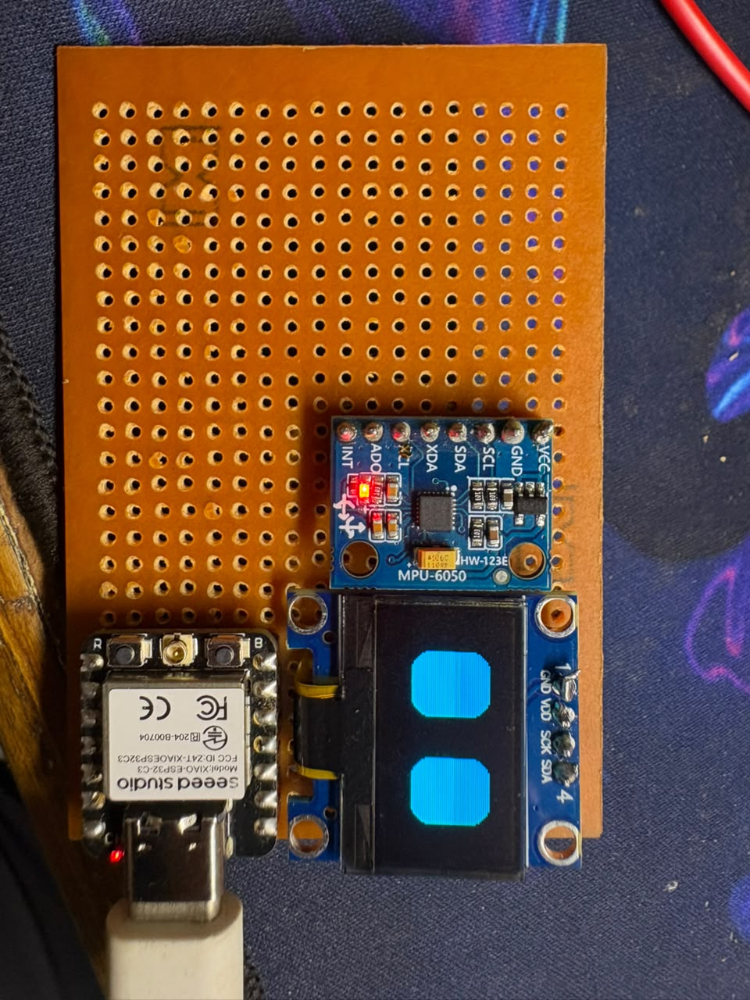
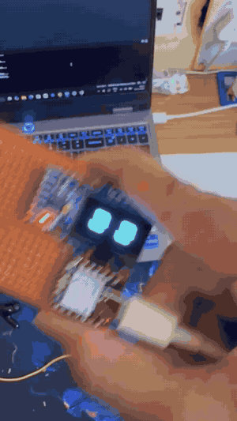
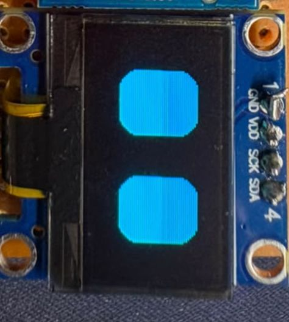
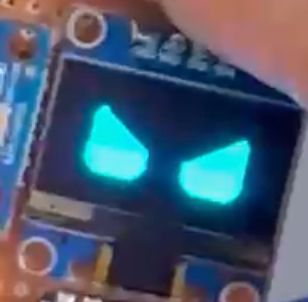
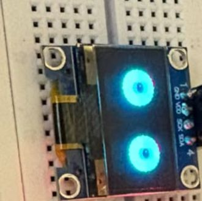
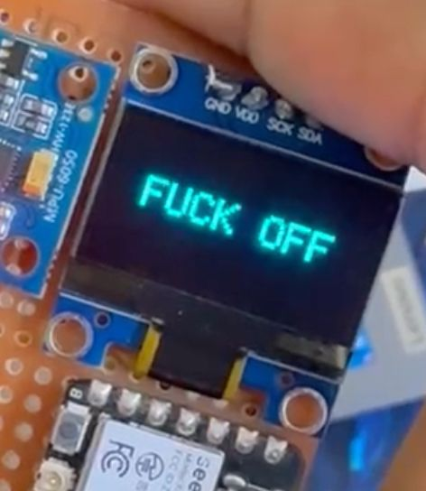
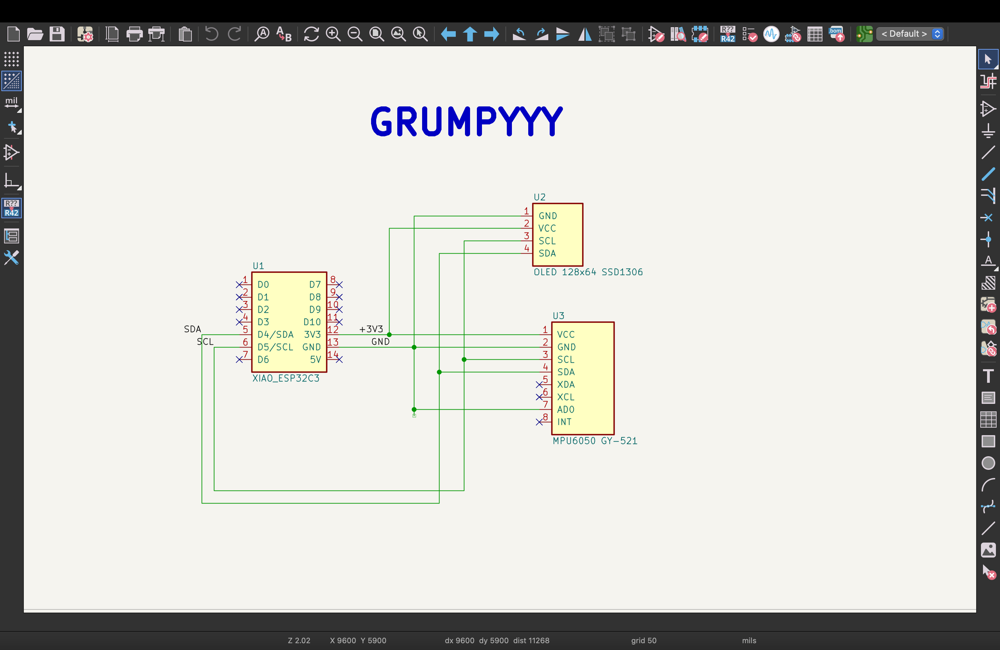
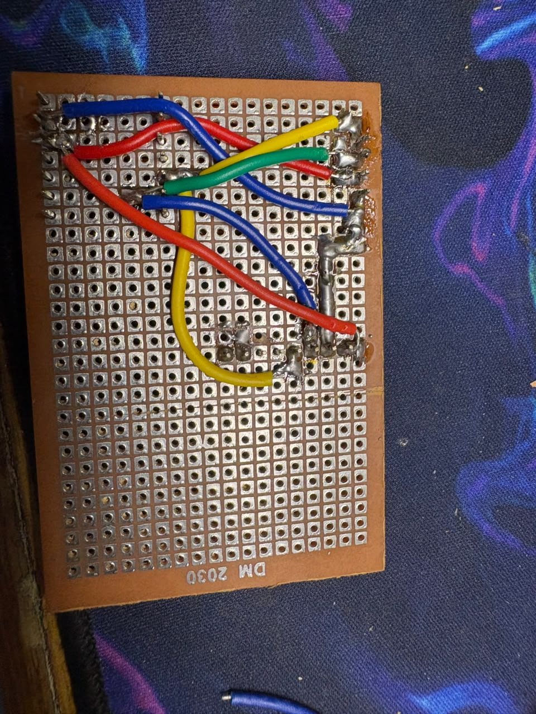
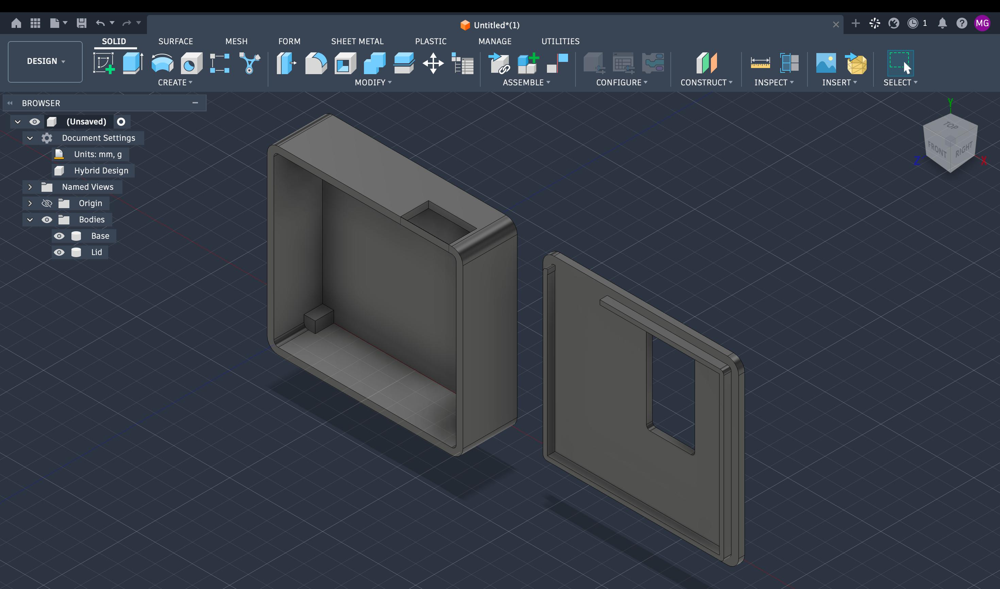

<h1 align="center"> Grumpyyy</h1>
<h3 align="center">A tiny USB-C keychain that blinks at you until you shake it. Then it has a few words for you.</h3>

<strong>Made by Mwezi</strong>

<a href="JOURNAL.md">Build journal</a> · <a href="media/testing-video.mp4">Full demo</a> · <a href="BOM.csv">Parts list</a>

I made this for my brother. He gets annoyed when someone messes with his stuff, so I figured his keychain should get annoyed too. The best part is what happens when you finally leave it alone.

 <em>Click the animation for the full test video.</em>

## How do you get on its nerves?

Plug it into a laptop with a USB-C cable. This version gets all its power from the cable.

| What you do | What Grumpyyy does |
| --- | --- |
| Let it sit | Blinks every 2–5 seconds. |
| Shake it for 2 seconds | Its eyebrows slide down and its eyes tremble. |
| Keep shaking | Every shake keeps it angry a little longer. |
| Leave it alone for about 5 seconds | It flashes **FUCK OFF** for 2 seconds, then goes back to blinking. |
| Shake it while the message is up | Straight back to angry eyes. |

## The faces

<table align="center">
<tr><th>Normal</th><th>Angry</th></tr>
<tr><td align="center"></td><td align="center"></td></tr>
</table>

<table align="center">
<tr><th>Round-eye experiment</th><th>Parting words</th></tr>
<tr><td align="center"></td><td align="center"></td></tr>
</table>

The main sketch uses the normal eyes, angry eyes and message. Round eyes were a separate experiment. You can try all four individually in the [face sketches](firmware/faces/).

## What’s inside?

A Seeed Studio XIAO ESP32-C3 reads the MPU6050 accelerometer directly over I²C. Sitting still, it measures about 1 g. A reading more than 0.6 g either side of that counts as a shake. The OLED shares the same two I²C wires and draws the face using Adafruit SSD1306 and GFX. Those angry eyebrows are two black triangles sliding over the eyes.

<table align="center">
<tr><th>KiCad schematic</th><th>Wiring on the perfboard</th></tr>
<tr><td align="center"></td><td align="center"></td></tr>
</table>

| XIAO pin | OLED | MPU6050 |
| --- | --- | --- |
| 3V3 | VCC | VCC |
| GND | GND | GND and AD0 |
| D4 (GPIO6) | SDA | SDA |
| D5 (GPIO7) | SCL | SCL |

Grounding AD0 gives the MPU6050 address `0x68`. The OLED uses `0x3C`. I drew the [schematic in KiCad](kicad/Grumpyyy.kicad_sch) and soldered the build on perfboard.

## The case

 <em>Base and lid in Fusion 360</em>

I put the USB-C cutout at the edge of the base so I could plug it in with the lid on. Four posts lift the board above the soldered wires, and a friction-fit lid frames the OLED. The [STEP model](cad/Grumpyyy-CAD.step) includes the base and lid. The [Fusion script](cad/GrumpyyyCase/) is there if you want to adjust the fit.

## Want to build one?

1. Gather the parts below and wire the two modules on a breadboard using the pin table.
2. In Arduino IDE, install the ESP32 board package and the Adafruit SSD1306 and Adafruit GFX libraries. Select **XIAO_ESP32C3** and enable **USB CDC On Boot**.
3. Open and upload [Grumpyyy.ino](firmware/Grumpyyy/Grumpyyy.ino). If the upload won’t start, hold the **B** (boot) button while plugging in the board.
4. Try the shake sequence on the breadboard. Once it works, solder the parts to perfboard, leaving the USB-C port accessible, and check the connections against the schematic.
5. Print the base and lid, seat the board on its posts and press the lid into place.

## Bill of materials

| Part | Quantity | Purpose | Approx. cost |
| --- | ---: | --- | ---: |
| XIAO ESP32-C3 | 1 | Runs the firmware | ₹500 |
| MPU6050 module | 1 | Detects shaking | ₹130 |
| 0.96-inch SSD1306 OLED | 1 | Displays the face | ₹230 |
| Perfboard | 1 | Holds the circuit | ₹30 |
| Hookup wire | 1 lot | Connects the modules | ₹40 |
| Male header pins | 1 strip | Mounts the modules | ₹15 |
| PLA | About 15 g | Base and lid | ₹30 |
| Key ring | 1 | Fits the case tab | ₹10 |
| **Total** | | | **₹985** |

I already had the solder, USB-C data cable, breadboard and jumpers. The [full BOM](BOM.csv) includes those items and the part specifications.
