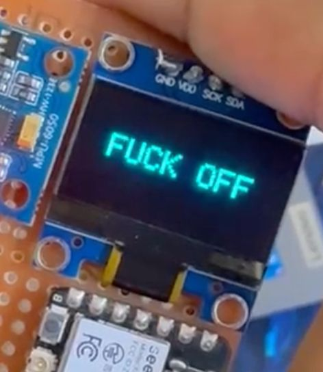
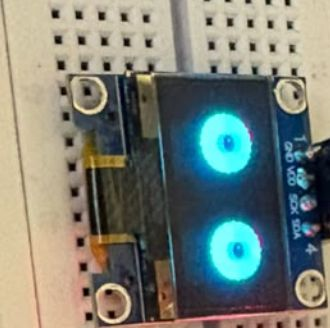
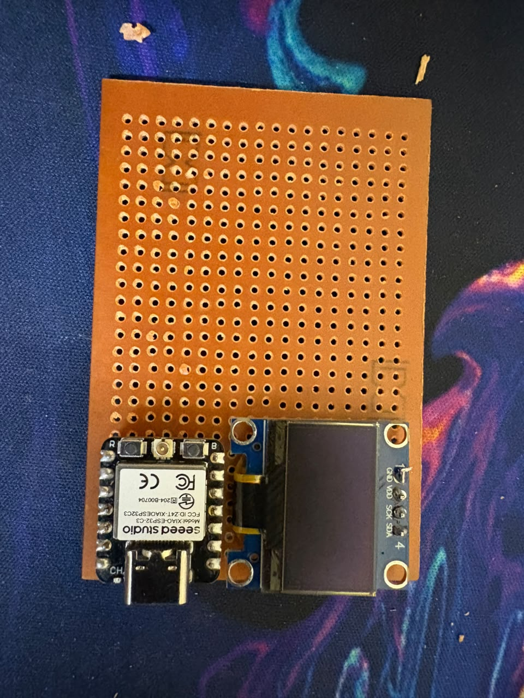
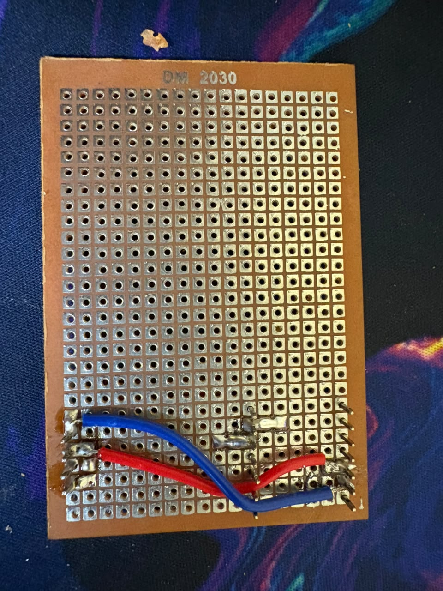

<h1 align="center">Grumpyyy build journal</h1>

<strong>Made by Mwezi</strong>

How I made my brother a keychain with his patience level.

<strong>11 sessions · 24.9 hours</strong> <a href="README.md">Project overview</a> · <a href="media/testing-video.mp4">Watch the final test</a>

---

## 1. A gift for my brother

**Time spent** · 1 hour

My brother gets annoyed when someone messes with his stuff. I wanted to make his gift myself, and that gave me an idea. What if his keychain got annoyed on his behalf?

I watched OLED eye animations and robot faces on YouTube and sketched out the joke. It would sit there blinking, get angry after two seconds of shaking, tell you to fuck off, then go right back to blinking like nothing happened.

 <em>The little face this idea turned into</em>

---

## 2. Picking parts that would actually fit

**Time spent** · 2 hours

An Arduino Uno would make a pretty ridiculous keychain. I picked the XIAO ESP32-C3 because it’s tiny and I could power and program it through the same USB-C port. A GY-521 module with an MPU6050 would sense the shaking, and a 0.96-inch, 128 × 64 SSD1306 OLED would be the face. Both speak I²C, so I only needed two signal wires on the perfboard.

I’d planned on a 3.7 V, 100 mAh battery that could wake the keychain when shaken. Once I counted the space for charging, USB power from my laptop made more sense for this version. I’m saving the battery idea for v2.

 <em>Parts laid out before wiring</em>

---

## 3. Drawing the schematic

**Time spent** · 2.5 hours

I couldn’t find the XIAO symbol I wanted in KiCad, so I made simple symbols for all three boards. My first drawing used net labels everywhere. When I sat down to follow a connection, I kept hunting for the matching label, so I redrew it with wires. Now I could follow each branch and see the junction dots.

Both modules share 3V3, GND, SDA on D4 (GPIO6) and SCL on D5 (GPIO7). I used the XIAO’s 3.3 V supply and tied AD0 to ground to put the MPU6050 at `0x68`, alongside the OLED at `0x3C`. I exported the netlist to check each pin before wiring anything.

 <em>The shared I²C bus in KiCad</em>

---

## 4. A breadboard full of wires and a blank screen

**Time spent** · 2 hours

I put the OLED at the top of the breadboard, the MPU6050 in the middle and the XIAO at the bottom, where I could reach it with the USB cable. I uploaded the sketch and got a completely blank screen.

Turns out I’d used GPIO8 and GPIO9 from a different ESP32-C3 board. I changed SDA and SCL to GPIO6 and GPIO7, and there were the eyes! My Arduino IDE setup was the ESP32 board package, **XIAO_ESP32C3**, and **USB CDC On Boot** enabled. On the uploads that refused to start, I held the boot button while plugging it in.

<table align="center">
<tr><th>Breadboard wiring</th><th>First eyes on the OLED</th></tr>
<tr><td align="center"></td><td align="center"></td></tr>
</table>

---

## 5. Teaching it when to get angry

**Time spent** · 3.5 hours

I drew two rounded rectangles with Adafruit SSD1306 and GFX and squashed them down for each blink. A random delay of 2–5 seconds kept the face from blinking like a clock. For the MPU6050, I read the acceleration registers directly over I²C.

At rest, the total acceleration is about 1 g. I counted a shake whenever it moved more than 0.6 g away from that. Two seconds of shaking triggered the angry face, and a gap longer than 0.4 seconds reset the buildup.

My first version only got angry once. It would also calm down five seconds later while I was *still shaking it*. I changed the timer so each new shake kept the angry face around. Finally, it had a reason to stay mad.

 <em>Normal eyes between blinks</em>

---

## 6. Two triangles and a parting message

**Time spent** · 2.8 hours

The same pair of eyes looked properly annoyed once I drew a black triangle across the top of each one, sloping down toward the middle. I eased the brows into place and added a random one-pixel tremble. I uploaded a lot of tiny changes to get that expression right.

After five quiet seconds, I gave it the line my brother would see: **FUCK OFF**. At text size 2 each character takes 12 × 16 pixels, so I could center the whole thing and still make it wobble. It stays up for two seconds. Shake it during the message and the angry eyes come straight back.

<table align="center">
<tr><th>Eyebrows down</th><th>The parting message</th></tr>
<tr><td align="center"></td><td align="center"></td></tr>
</table>

---

## 7. Trying a much more innocent face

**Time spent** · 2.6 hours

I split the normal eyes, angry eyes, text and round eyes into four sketches so I could upload whichever one I was working on. The round face got white circles, black pupils and a tiny white highlight in each pupil.

Every 1–3 seconds the pupils pick a new spot and glide over to it. For a blink, I bring black bars in from the top and bottom. This one looked so sweet on the breadboard, which is pretty funny given what the other sketch says.

 <em>Round eyes with moving pupils</em>

---

## 8. Finding room on the perfboard

**Time spent** · 1.3 hours

Before committing to solder, I tried a few arrangements. I liked the OLED and XIAO side by side with the MPU6050 tucked below the screen. That put the USB-C port right at the edge where I could still plug it in.

I flipped the board and traced the modules with a marker so I could tell which pins belonged to which part. I left the spare perfboard attached until the wiring was done.

<table align="center">
<tr><th>Trying the layout</th><th>Outlines marked on the back</th></tr>
<tr><td align="center"></td><td align="center"></td></tr>
</table>

---

## 9. My first perfboard wiring

**Time spent** · 2.7 hours

I soldered the XIAO and OLED in place, flipped the board and started with power. Red went to 3V3, blue to ground. I joined a row of ground pads with solder to save a wire.

This was my first proper go at perfboard wiring. Some joints came out blobby and I redid them. Tinning the end of each wire first made the next few joints much easier.

<table align="center">
<tr><th>XIAO and OLED in place</th><th>First power connections</th></tr>
<tr><td align="center"></td><td align="center"></td></tr>
</table>

---

## 10. Powering up the soldered board

**Time spent** · 2.9 hours

I added the MPU6050, ran green and yellow wires for SDA and SCL to both modules, and tied AD0 to ground. The crossings got crowded. I kept the schematic beside me and checked continuity with a multimeter, especially between 3V3 and ground, before plugging it in.

The eyes came on first try :D After all those wires on the back, that felt good. Then I trimmed the extra perfboard down to size.

<table align="center">
<tr><th>Finished wiring</th><th>First power-up on perfboard</th></tr>
<tr><td align="center"></td><td align="center"></td></tr>
</table>

---

## 11. One last shake

**Time spent** · 1.6 hours

I ran the whole sequence again. Blinking eyes, two seconds of shaking, angry eyebrows. I kept shaking and it stayed mad. I put it down, waited about five seconds, and got my two-word goodbye.

This little gift took me through I²C, reading a sensor directly, OLED animation, KiCad and perfboard soldering. Next time I’d like to give it a battery so it can do all this away from my laptop. Maybe a few more faces, too. For now I just want to see my brother’s reaction.

[Watch the final test](media/testing-video.mp4)

 <em>Testing the finished build</em>

