<div align="center">
  <h1>Grumpyyy</h1>
  <h3>by shadow</h3>
  <h3>total time spent : 28.3 hours </h3>
</div>

--- 

### journal #1 a gift for my bro  
time spent : 1 hour   

  
so this whole thing started because of my bro. his birthday was coming up and i didnt want to just order something off amazon again, i wanted to give him something i actually made with my own hands  
  
he gets annoyed super easily when anyone touches his stuff lol, so the idea was a keychain that ALSO gets annoyed. normally it just sits there and blinks at you, but if you shake it, it gets angry, and if you keep messing with it, it tells you to fuck off. honestly thats just him as a keychain  
  
spent this hour watching oled eye animation videos on youtube (theres a lot of cute robot face stuff out there) and writing down what i wanted it to do in my notes app
  

<div align="center">
  
| what i was going for |
| --- |
| 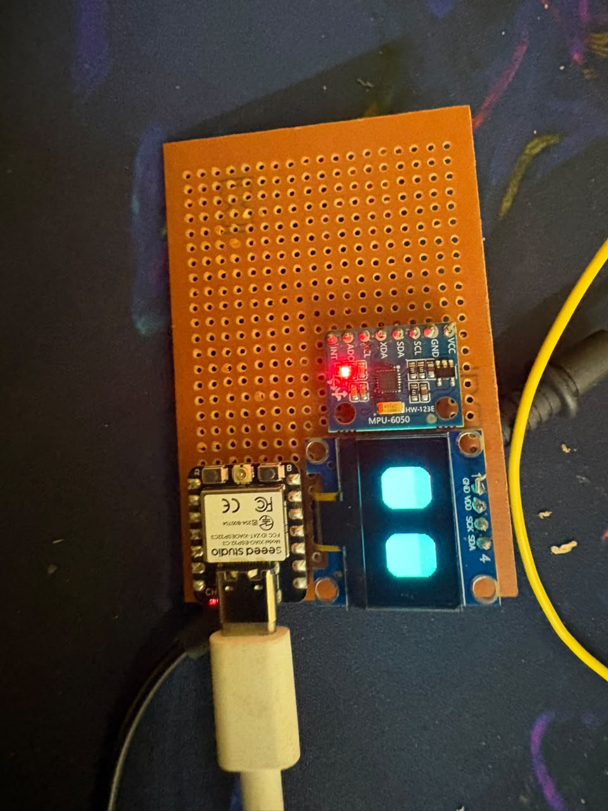 |

</div>

--- 

### journal #2 picking the parts  
time spent : 1.5 hours   

  
its a keychain so everything has to be tiny. an arduino uno was out straight away  
  
the brain is a seeed studio xiao esp32-c3. its like the size of a thumbnail, has usb-c on it, and i can program and power it from the same cable. for the shake i went with an mpu6050 (the gy-521 module), its an accelerometer + gyro and i already had one lying around from my self balancing bot. for the face, a 0.96 inch 128x64 oled with the ssd1306 driver, only 4 pins  
  
best part is the oled and the mpu6050 both talk i2c, so they can sit on the same 2 wires. that makes the wiring way less painful
  

<div align="center">
  
| all the parts |
| --- |
|  |

</div>

--- 

### journal #3 the battery idea that didnt make it  
time spent : 0.5 hours   

  
originally i wanted a 3.7v 100mah lipo inside so it works on its own, and it would sleep and wake up when you shake it to save battery. looked into it for a bit and it needs a charging circuit, a switch, and more space in the case. too much for the first version tbh  
  
so v1 just runs off usb-c from my laptop. battery is a v2 thing
  

<div align="center">
  
| the xiao, usb-c on top is how it gets power |
| --- |
| 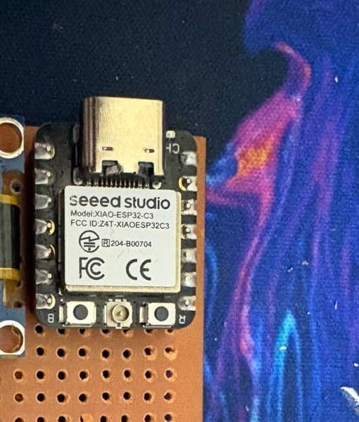 |

</div>

--- 

### journal #4 making symbols in kicad  
time spent : 1.2 hours   

  
i wanted a schematic before touching a single wire so i dont mess up the connections later. problem was kicad didnt have a xiao esp32-c3 symbol, or the gy-521, or the oled module, at least not the way i wanted them  
  
so i made my own simple symbols for all 3. the xiao has all 14 pins (D0 to D10, 3V3, GND, 5V), the oled has GND, VCC, SCL, SDA in the same order as the pins on the real module, and the mpu6050 has all 8 pins. the unused pins got the little x (no connect) so erc doesnt yell at me
  

<div align="center">
  
| xiao symbol | oled symbol |
| --- | --- |
|  | 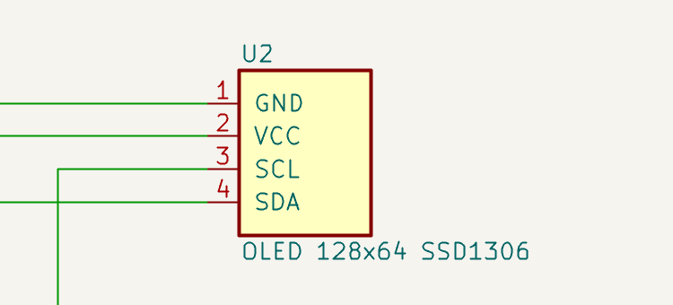 |

</div>

--- 

### journal #5 wiring the schematic  
time spent : 1 hour   

  
the circuit itself is pretty simple, its only 4 nets :
- 3V3 from the xiao goes to VCC on the oled and the mpu6050
- GND to GND on both
- D4 (gpio6) is SDA, goes to both
- D5 (gpio7) is SCL, goes to both

AD0 on the mpu6050 goes to gnd so its address is 0x68, and the oled is 0x3c, so they dont fight on the bus. also used 3v3 and not 5v for the modules because the xiao pins are 3.3v  
  
first i did it all with net labels. it worked but looking at it i couldnt tell what goes where, so i redid it with actual wires from the xiao to each module. looks way clearer now. the dots are where wires join, if two wires just cross with no dot theyre not connected (took me a minute to get that lol)
  

<div align="center">
  
| the full schematic |
| --- |
| 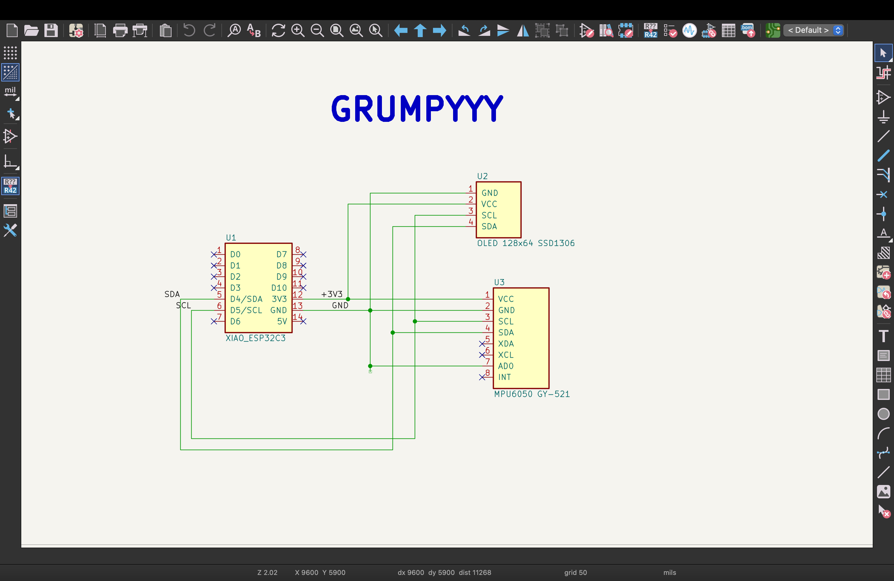 |

</div>

--- 

### journal #6 breadboard first  
time spent : 1 hour   

  
no way i was soldering before knowing it works. stuck everything on a breadboard, oled at the top, mpu6050 in the middle, xiao at the bottom with the cable going to my laptop  
  
the jumper wires got messy really fast but for testing who cares
  

<div align="center">
  
| breadboard setup |
| --- |
| 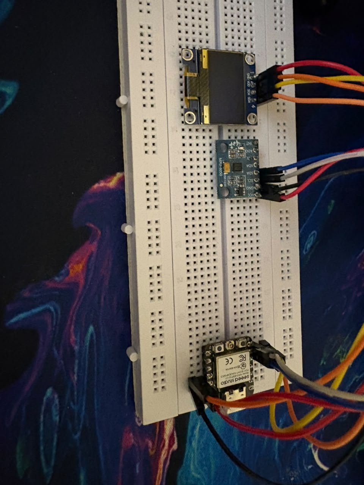 |

</div>

--- 

### journal #7 why is the screen blank  
time spent : 1 hour   

  
uploaded a test sketch and... nothing. black screen  
  
spent way too long checking wires before realising the code had the i2c pins for a different esp32-c3 board (gpio8 and gpio9). on the xiao, sda is D4 which is gpio6 and scl is D5 which is gpio7. changed two numbers and the screen turned on :D  
  
some other stuff i had to figure out here: install the esp32 board package in arduino ide, pick XIAO_ESP32C3 and turn on "USB CDC On Boot" or serial monitor shows nothing. and sometimes the upload just wouldnt start, so i had to hold the B (boot) button while plugging it in
  

<div align="center">
  
| the xiao on the breadboard |
| --- |
| 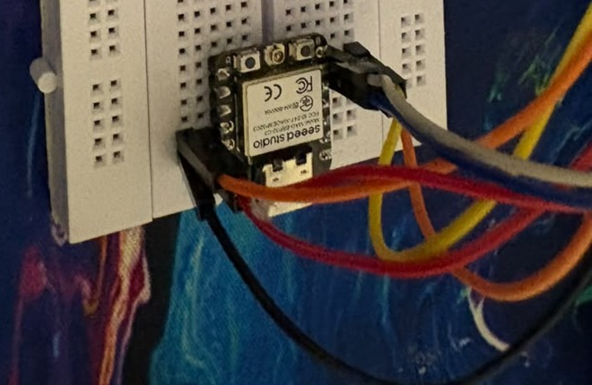 |

</div>

--- 

### journal #8 reading the mpu6050 with no library  
time spent : 1.5 hours   

  
i didnt want another library just for this so i read the mpu6050 straight over i2c. you write 0 to register 0x6B to wake it up (it starts asleep), set register 0x1C to the ±4g range, and then read 6 bytes from 0x3B. thats x, y and z, each one is 2 bytes  
  
at ±4g, 8192 means 1g, so i just divide by 8192. printed it in the serial monitor and when its flat on the table z reads about 1, which is gravity. that was a nice "ok it actually works" moment
  

<div align="center">
  
| the mpu6050 on the breadboard |
| --- |
| 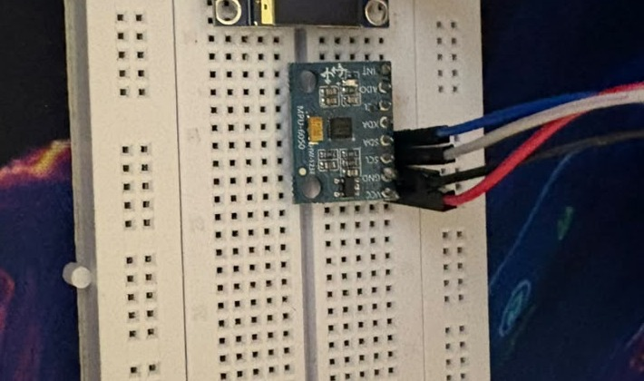 |

</div>

```cpp
int16_t z = (Wire.read() << 8) | Wire.read();
az = z / 8192.0;   // 1.0 = gravity when its sitting still
```

--- 

### journal #9 shake detection and moods  
time spent : 1.5 hours   

  
when the keychain is still, the total acceleration (sqrt of x² + y² + z²) is about 1g no matter which way its facing. so if it goes more than 0.6g away from 1, i count it as shaking. keep shaking for 2 seconds and it switches to angry. if you stop for more than 0.4 sec the 2 second timer resets, so a random bump doesnt set it off  
  
the code is a small state machine with 3 moods, NORMAL, ANGRY and SAYING (the text part)  
  
first version had a dumb bug. it got angry once, and even while i was still shaking it, it calmed down after 5 seconds. fixed it so every shake while its angry restarts the 5 sec timer, now it stays angry the whole time youre messing with it. way more accurate to my bro
  

<div align="center">
  
| shaking it (sorry for the blur) |
| --- |
| 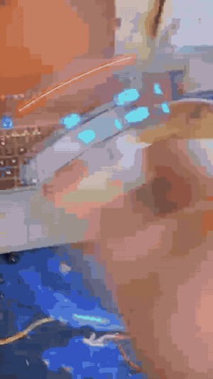 |

</div>

--- 

### journal #10 normal eyes and blinking  
time spent : 1 hour   

  
the normal eyes are two rounded rectangles, 34x40 pixels each. to blink i squash the height down to almost nothing and back up over 180ms. the next blink happens at a random time between 2 and 5 seconds, because if it blinks at exactly the same rhythm it looks like a robot (which, ok, it is, but still)
  

<div align="center">
  
| normal eyes |
| --- |
|  |

</div>

--- 

### journal #11 angry eyes  
time spent : 1.5 hours   

  
favourite part of the whole build. for the angry look i kept the same eyes and drew a black triangle over the top of each one, slanting down towards the middle. that cuts the eye into an angry eyebrow shape. for the left eye the triangle drops on the right side and for the right eye on the left, so both point at the nose  
  
the triangle fades in instead of just popping on, it looks way smoother. i also made both eyes shake by 1 pixel randomly every frame, so it looks like its literally shaking with anger lol
  

<div align="center">
  
| angry eyes |
| --- |
|  |

</div>

--- 

### journal #12 the fuck off part  
time spent : 1.3 hours   

  
this is the bit my bro is gonna see. when the angry mode ends it shows FUCK OFF in big letters in the middle of the screen for 2 seconds, with the same small shake, then goes back to normal eyes. if you shake it again while the text is up it goes straight back to angry  
  
text size 2 makes every letter 12x16 pixels, so about 10 letters fit across. i used getTextBounds to center it properly, before that it was a few pixels off to the left and it was bugging me
  

<div align="center">
  
| it said it |
| --- |
|  |

</div>

--- 

### journal #13 round eyes and a sketch for every face  
time spent : 1.8 hours   

  
after the main stuff worked i wanted to play with more faces, so i split every face into its own sketch in `firmware/faces` so i can test them one at a time: normal eyes, angry eyes, the text, and a new one, round eyes  
  
the round eyes are a big white circle with a black pupil and a tiny white dot for the shine. every 1 to 3 seconds the pupils pick a random spot and slide there instead of teleporting (i move them 20% of the way each frame). blinking is two black bars closing in from the top and bottom  
  
they look so cute on the breadboard. funny that the same keychain will later tell you to fuck off
  

<div align="center">
  
| round eyes | on the breadboard |
| --- | --- |
|  |  |

</div>

--- 

### journal #14 figuring out the perfboard layout  
time spent : 1.3 hours   

  
before soldering i moved the parts around on the perfboard to find the smallest layout. first try was the mpu6050 on top with the oled and xiao side by side under it, but it was kinda wide. then i tried oled and xiao next to each other with the mpu6050 under the oled  
  
the thing i really cared about was the usb-c staying at the edge so the cable can still go in
  

<div align="center">
  
| first try | second try |
| --- | --- |
| 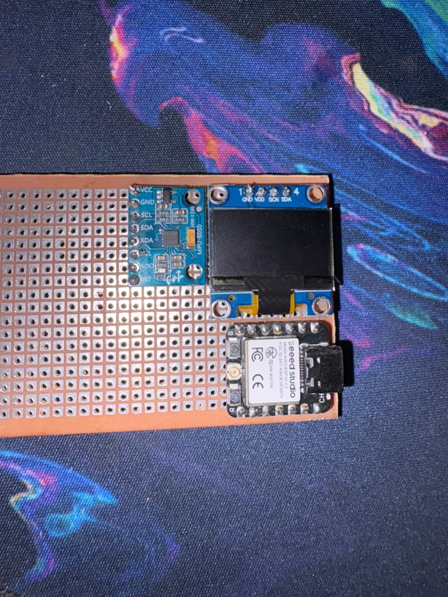 |  |

</div>

in the end i flipped it again and put the mpu6050 above the oled with the xiao on the left, thats what you see in the final pics

--- 

### journal #15 marking the back  
time spent : 0.5 hours   

  
flipped the board and marked where each part's pins come through with a marker, so when im soldering from the back i know whats what. left the extra board on for now, its easier to hold while soldering and i can cut it later
  

<div align="center">
  
| marked back |
| --- |
|  |

</div>

--- 

### journal #16 soldering the xiao and oled  
time spent : 1.2 hours   

  
started with the xiao and the oled since theyre the big ones. tacked one pin on each first, checked they were straight, then did the rest  
  
my first few joints were blobby ngl, had to reheat a couple. but by the end of the headers i was getting cleaner cones
  

<div align="center">
  
| xiao and oled in |
| --- |
|  |

</div>

--- 

### journal #17 power wires  
time spent : 1.5 hours   

  
then the wiring on the back. red for 3v3, blue for gnd. first time doing proper wiring on perfboard so this was slow. i also dragged a solder bridge along one row for gnd so i didnt need an extra wire there  
  
biggest lesson: tin the wire before you solder it. i did the first one without and it was a nightmare, after that it was way easier
  

<div align="center">
  
| first power wires |
| --- |
|  |

</div>

--- 

### journal #18 mpu6050 and the i2c wires  
time spent : 1.7 hours   

  
soldered in the mpu6050, then the green and yellow wires for sda and scl going to both the oled and the mpu. plus a short one tying AD0 to gnd  
  
it got crowded where the wires cross over each other, so i kept the schematic open on my laptop and checked every single wire against it before moving on
  

<div align="center">
  
| wiring in progress | all wired |
| --- | --- |
| 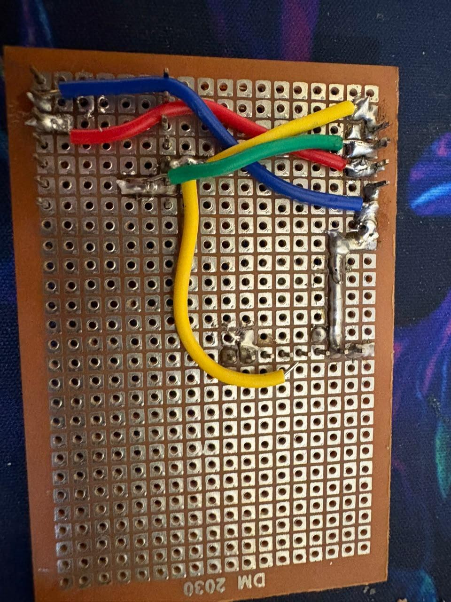 |  |

</div>

--- 

### journal #19 first power on  
time spent : 1.2 hours   

  
before plugging it in i went over everything with the multimeter in continuity mode. mainly checking 3v3 and gnd werent shorted, because i really didnt want to fry the xiao  
  
plugged it in and the eyes came on first try :D genuinely the best feeling of the whole project. then i cut off the extra perfboard i didnt need so it's actually keychain sized
  

<div align="center">
  
| it lives |
| --- |
|  |

</div>

--- 

### journal #20 the case base in fusion  
time spent : 1.8 hours   

  
now it needed a case so it looks like a keychain and not a random board. measured the board with calipers (around 48 x 44mm with everything on it) and made the case in fusion 360 as a python script, so if my measurements are off i just change a number at the top and run it again  
  
the base is an open box with 1.8mm walls and 4 little posts in the corners for the board to sit on, with 5mm of space underneath for all the wires and solder blobs. it has a cutout for the usb-c and a keyring tab at the bottom with a 4.5mm hole
  

<div align="center">
  
| the base |
| --- |
|  |

</div>

--- 

### journal #21 the lid  
time spent : 1.4 hours   

  
the lid is a flat 1.6mm plate with a window for the oled and a 2mm lip that pushes into the base and holds by friction. i gave the lip 0.2mm clearance per side, if its too tight ill bump it to 0.3  
  
its meant to print face down so the top comes out clean. this got me for a bit: when you flip the lid to print it, the window position gets mirrored, so the window was on the wrong side the first time. fixed it in the script
  

<div align="center">
  
| the lid | both parts |
| --- | --- |
| 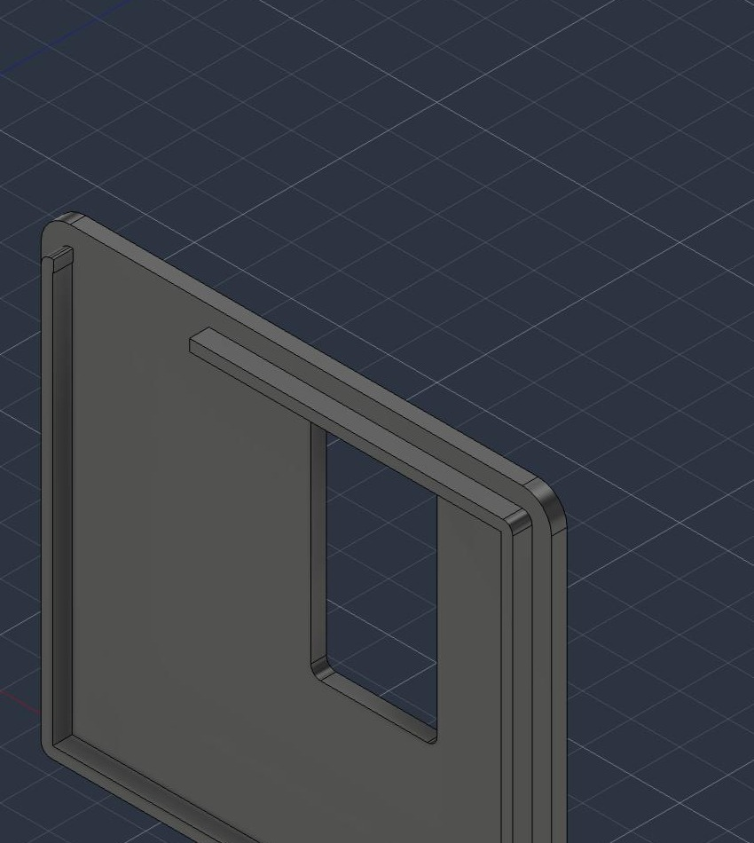 | 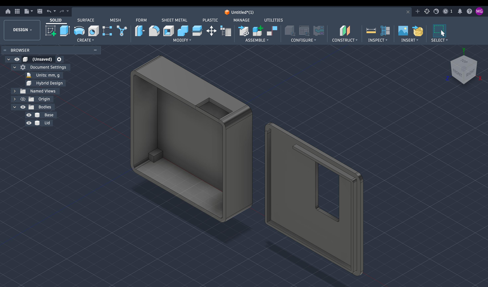 |

</div>

--- 

### journal #22 final testing  
time spent : 1.1 hours   

  
tested the whole thing again a bunch of times. it blinks normally, shake it for 2 sec and it goes angry, keep shaking and it stays angry, stop and 5 sec later it says fuck off and calms down. tried shaking it again during the text and it went right back to angry, perfect  
  
the threshold of 0.6g felt right, walking around with it doesnt set it off but a proper shake does
  

<div align="center">
  
| angry | then this |
| --- | --- |
| 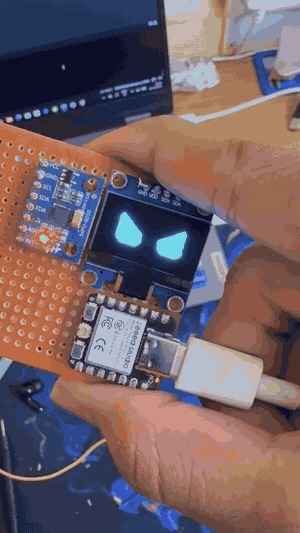 | 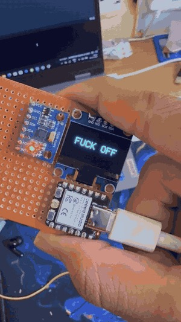 |

</div>

here is the testing video : <a href="media/testing-video.mp4">testing video</a>

<div align="center">
  
| testing it |
| --- |
| 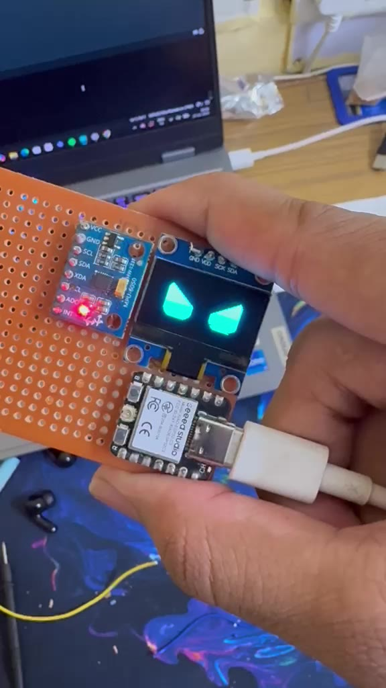 |

</div>

--- 

### journal #23 readme and github  
time spent : 0.8 hours   

  
made a gif from the testing video for the readme, wrote the readme and the bom, and pushed everything to github. the case is designed, next is printing it and putting the board inside  
  
learned a ton from this one, i2c, reading a sensor without a library, oled animations, kicad symbols, perfboard soldering and fusion scripts. v2 is getting a battery and maybe more faces. cant wait to see my bro's reaction lol
  

<div align="center">
  
| grumpyyy |
| --- |
| 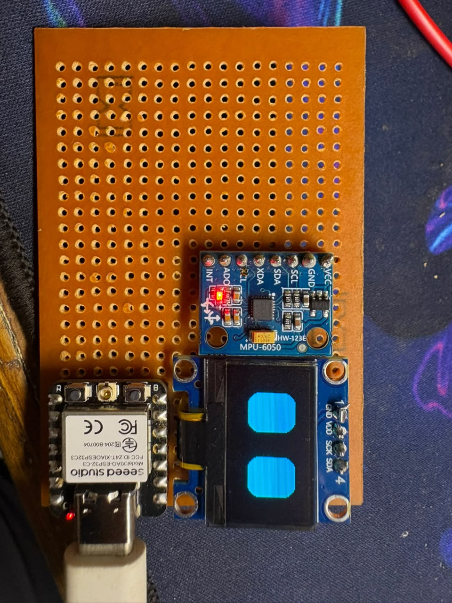 |

</div>

if you read till here, thank you :D
