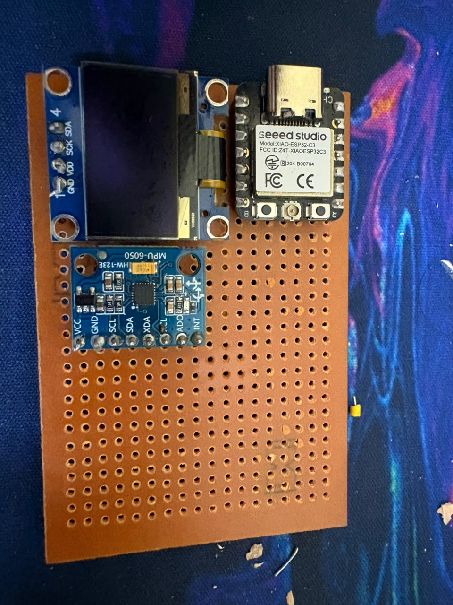
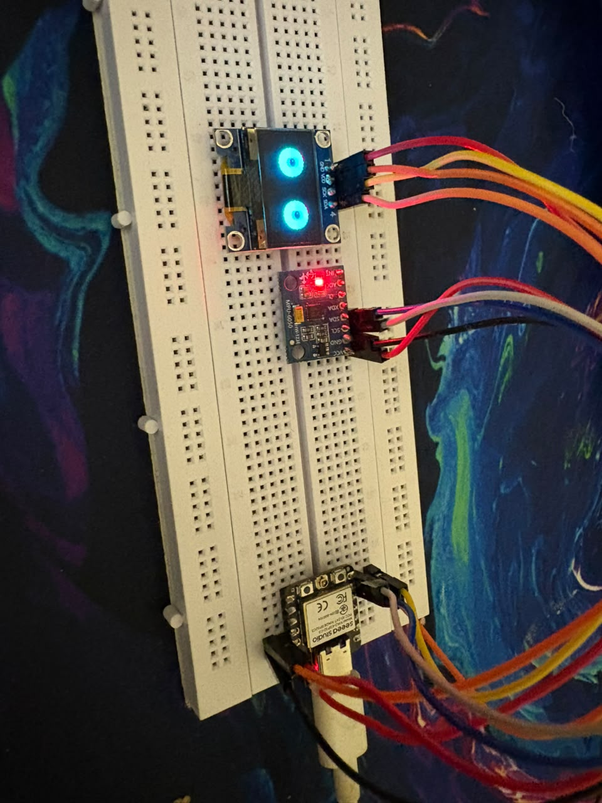
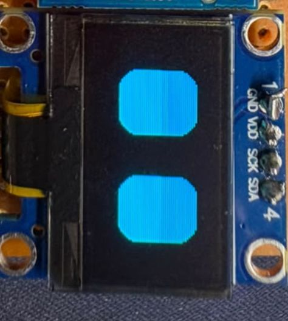
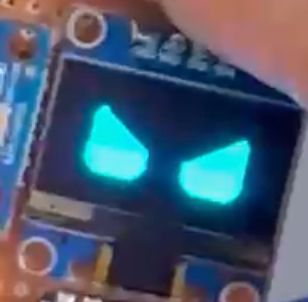
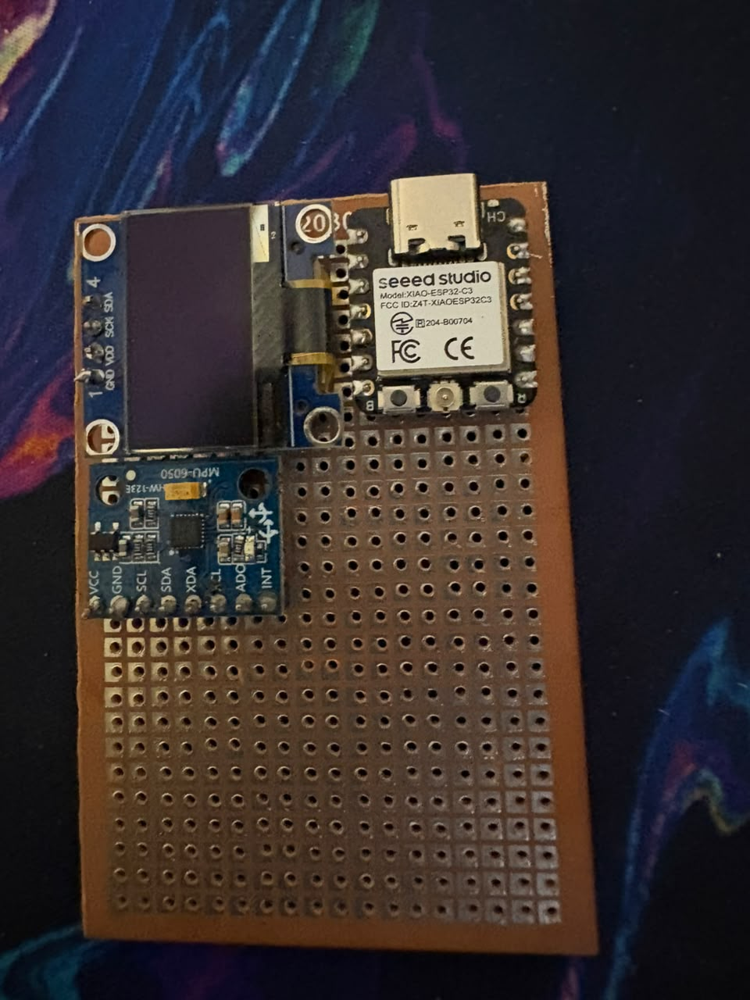
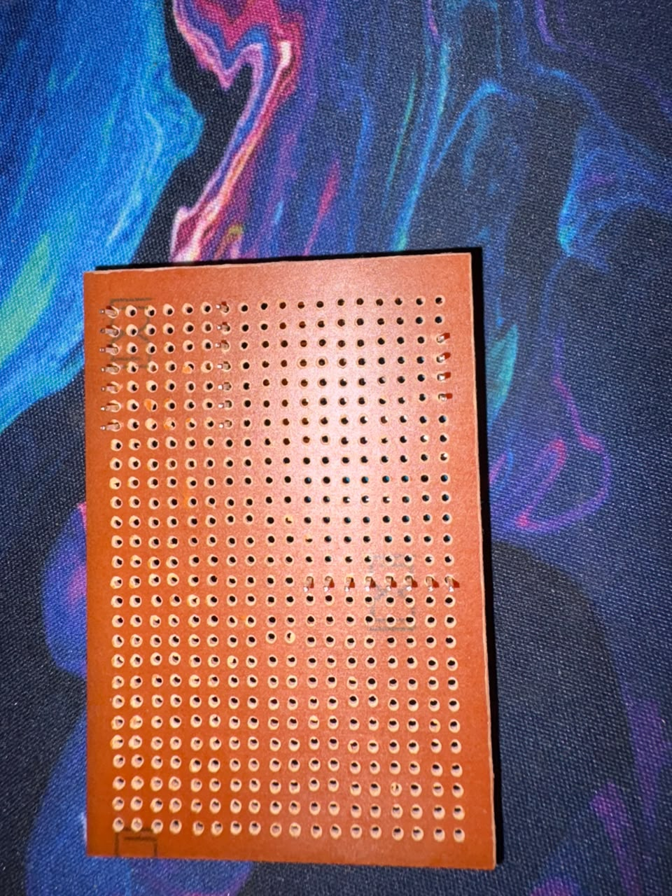
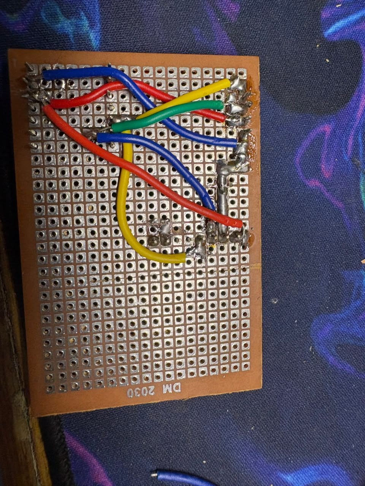

# Grumpyyy

Total time spent : 31 hours

---

### JOURNAL #1 Why this keychain

Time spent : 1 hour

so the idea for this came from my bro. i wanted to make him a gift that was actually made by me and not just bought from amazon. he always gets annoyed when someone messes with his stuff so i thought it would be funny to make a keychain that also gets annoyed lol

the plan was simple, a small keychain with a tiny screen that shows eyes. normally the eyes just chill and blink, but if you shake it for 2 seconds it gets angry, and at the end it tells you to fuck off. then it calms down and goes back to normal

i spent this time watching a few videos of oled eye animations and robot faces on youtube and writing down what i wanted it to do. i had no idea how hard it would be but it looked doable for a beginner like me

---

### JOURNAL #2 Finalising the design and components

Time spent : 2 hours

next i had to pick the parts. it had to be small because its a keychain, so i couldnt use a big arduino uno or something

this is what i finalised :
- seeed studio xiao esp32-c3 as the brain, its tiny and has usb-c on it so i can program and power it from the same cable
- mpu6050 (gy-521) to detect the shake, its an accelerometer + gyro
- 0.96 inch 128x64 oled screen (ssd1306), i2c, only 4 pins
- a small perfboard to put everything on

at first i wanted to add a 3.7v 100mah battery and make it wake up when you shake it to save power. but that needs a charging circuit and more space so for this version i decided to power it only from my laptop through usb-c. battery can be a v2 thing

good thing is both the oled and the mpu6050 use i2c, so they can share the same 2 wires (sda and scl). that makes the wiring way less

---

### JOURNAL #3 Designing the schematics

Time spent : 2.5 hours

before connecting anything i made the schematic in kicad so i dont mess up the wiring

the connections are pretty simple :
- 3v3 of xiao goes to vcc of the oled and the mpu6050
- gnd goes to gnd of both
- d4 (gpio6) is sda, goes to sda of both
- d5 (gpio7) is scl, goes to scl of both
- ad0 of the mpu6050 goes to gnd so its address is 0x68, the oled is 0x3c so they dont clash

one thing i learned here is to use 3v3 and not 5v for the modules, the xiao pins are 3.3v

i didnt find a xiao symbol in kicad so i made simple symbols for all 3 parts. first i connected everything using net labels, it worked but it looked confusing to me, so i redid it with actual wires going from the xiao to each module. the dots show where wires join, if 2 wires just cross without a dot they are not connected. then i exported the netlist to check that every pin was on the right net

---

### JOURNAL #4 Testing it on breadboard

Time spent : 2 hours

i didnt want to solder anything before knowing it works so i put everything on a breadboard first with jumper wires

i put the oled on top, mpu6050 in the middle and the xiao at the bottom with the usb cable going to my laptop. the jumper wires got messy really fast but it was fine for testing

first problem : the screen was blank. turned out my code had the i2c pins for a different esp32-c3 board (gpio8 and gpio9). on the xiao, sda is d4 (gpio6) and scl is d5 (gpio7). after changing that the screen turned on :D

also had to install the esp32 board package in arduino ide and select XIAO_ESP32C3, and turn on "USB CDC On Boot". sometimes upload didnt start so i had to hold the boot button while plugging it in

---

### JOURNAL #5 Writing the code - firmware

Time spent : 3.5 hours

this part took the longest to get right

i used the adafruit ssd1306 and adafruit gfx libraries for the screen. for the mpu6050 i didnt use any library, i just read the accelerometer registers directly over i2c, its only a few lines

how the shake detection works : when the keychain is still, total acceleration is about 1g (gravity). if it goes more than 0.6g away from 1g, i count it as shaking. if you keep shaking for 2 seconds it switches to angry mode. if you stop for more than 0.4 sec the timer resets

the code works like a small state machine :
- normal : eyes blink at a random time every 2 to 5 sec
- angry : shake for 2 sec to get here
- after 5 sec of no shaking it goes back to normal

first version had a bug, it only got angry once, and even if i kept shaking it calmed down after 5 sec. i fixed it so every shake while its angry restarts the 5 sec timer. now it stays angry as long as you keep shaking it

the first eyes were just rounded rectangles that squash down when they blink

---

### JOURNAL #6 Making my own emojis - angry eyes and fuck off

Time spent : 3 hours

now the fun part, making it actually look angry

for the angry eyes i used the same rounded rectangle eyes and drew a black triangle over the top of each eye, slanting down towards the middle. it looks like angry eyebrows. i also made the eyes shake by 1 pixel randomly so it looks like its shaking with anger lol. the triangle fades in slowly instead of popping in, it looked smoother that way

then i added the main thing my bro will see. when the angry mode ends, it shows "FUCK OFF" in big text in the middle of the screen for 2 sec, with the same little shake, then goes back to normal eyes. if you shake it again while the text is on, it goes straight back to angry

text size 2 means every letter is 12x16 pixels so about 10 letters fit on the screen

took a lot of uploading and changing numbers to make it look right

---

### JOURNAL #7 Round eyes and normal eyes

Time spent : 3 hours

after the angry ones worked i wanted to try more faces, so i made separate sketches for each face so i can test them one by one :
- normal eyes (the rounded squares that blink)
- angry eyes
- fuck off text
- round eyes

the round eyes were new. each eye is a big white circle with a black pupil and a small white dot for the shine. the pupils move to a random spot every 1 to 3 sec and slide there smoothly instead of jumping. for blinking i draw black bars from the top and bottom that close in on the eye

the round eyes look really cute on the breadboard, its kind of funny that the same keychain will tell you to fuck off

---

### JOURNAL #8 Planning the perfboard layout

Time spent : 1.5 hours

before soldering i had to figure out where everything goes on the perfboard so it stays small

i tried a few placements. the one i liked was the oled and the xiao next to each other with the mpu6050 below the oled. the usb-c of the xiao sits at the edge of the board so i can still plug in the cable

i marked the outlines of the parts on the back of the perfboard with a marker so i know where the pins come through, and kept the extra board for now so i could cut it later

---

### JOURNAL #9 Assembly on perfboard - soldering part 1

Time spent : 3 hours

started soldering. first i soldered the xiao and the oled onto the board, then flipped it and started the wiring on the back

first i did the power wires, red for 3v3 and blue for gnd. this was my first time doing proper wiring on perfboard so it was slow. some joints were blobby and i had to redo them. i also made a solder bridge along a row for gnd so i dont need extra wire there

lesson learned : tin the wire before soldering it, its way easier

---

### JOURNAL #10 Completing the soldering

Time spent : 3.5 hours

then i added the mpu6050 and did the rest of the wiring. green and yellow wires for sda and scl going to both the oled and the mpu6050, plus the ad0 pin connected to gnd

it got a bit crowded where the wires cross but i kept checking against my schematic. before powering it i checked everything with a multimeter in continuity mode, especially that 3v3 and gnd were not shorted

plugged it in and the eyes came on the first time :D that was a really good feeling

after that i cut off the extra perfboard that wasnt needed so the keychain is smaller

---

### JOURNAL #11 Designing the case

Time spent : 4 hours

now it needed a case so it actually looks like a keychain and not a random board

i designed it in fusion 360. i measured the board with all the parts on it with calipers and made the case parametric, so if my measurements are a bit off i can just change the numbers and it updates

the case has 2 parts :
- base : an open box with 4 small posts in the corners so the board sits on them, with 5mm of space underneath for the wires. it has a cutout for the usb-c and a keyring tab with a 4.5mm hole
- lid : a flat plate with a window for the oled and a lip that pushes into the base so it holds by friction. i kept 0.2mm clearance on the lip, if its too tight i will change it to 0.3

the lid is made to print upside down so it comes out clean. i also learned that when you flip the lid to print it, the window position gets mirrored, so i had to be careful about that

---

### JOURNAL #12 Final assembly and testing

Time spent : 2 hours

put the board into the case, closed the lid and tested everything again. it blinks normally, shake it for 2 sec and it gets angry, keep shaking and it stays angry, stop and after 5 sec it says fuck off and calms down

here is the testing video :

<a href="media/testing-video.mp4">testing video</a>

overall i learned a lot from this, i2c, reading a sensor without a library, making animations on an oled, kicad, soldering on perfboard and designing a case in fusion. cant wait to give it to my bro and see his reaction lol

next i want to add a battery so it doesnt need the laptop, and maybe more faces

---
