<h1 align="center">
  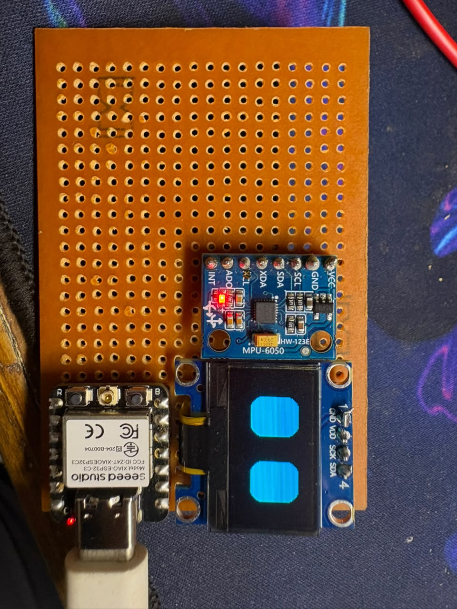<br>
  Grumpyyy
</h1>

<h3 align="center">a tiny keychain that blinks at you, gets angry when you shake it, and then tells you to fuck off :D</h3>

<p align="center">xiao esp32-c3 · mpu6050 · 0.96" 128x64 oled · perfboard · fusion 360 case</p>

---

## why was it made?

i made this as a birthday gift for my bro. i wanted to give him something i actually built myself instead of ordering something again, and he gets annoyed whenever anyone touches his stuff. so a keychain that gets annoyed and tells you to fuck off felt like the perfect thing for him lol

along the way i learned i2c, reading a sensor without a library, oled animations, making kicad symbols, soldering on perfboard and scripting a case in fusion. the full build log is in [JOURNAL.md](JOURNAL.md)

## demo

it chills and blinks. shake it for 2 seconds and the eyes go angry. keep shaking and it stays angry. stop, and 5 seconds later it says FUCK OFF and calms back down. click the gif for the full video

<p align="center">
  <a href="media/testing-video.mp4">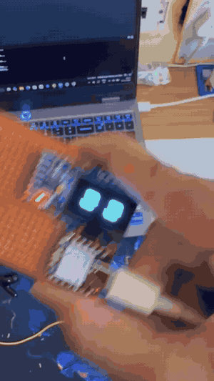</a>
</p>

## how to use

plug it into a laptop (or any usb power) with a usb-c cable and shake it

| what you do | what it does |
| --- | --- |
| nothing | normal eyes, blinks every 2 to 5 sec |
| shake it for 2 sec | angry eyes with eyebrows, eyes tremble |
| keep shaking | stays angry |
| stop shaking for 5 sec | shows FUCK OFF for 2 sec, then back to normal |
| shake during the text | straight back to angry |

## faces

| normal | angry | round | text |
| --- | --- | --- | --- |
| 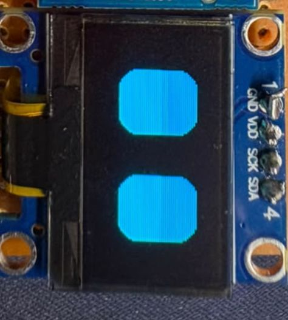 | 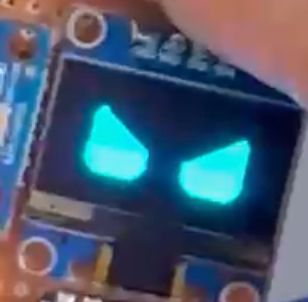 | 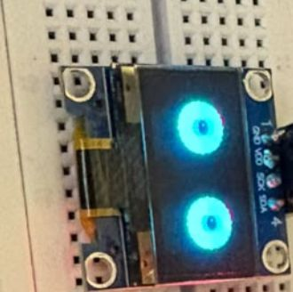 | 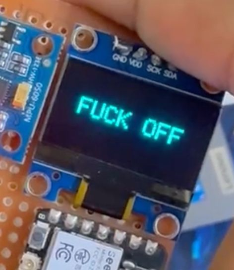 |

the main firmware uses normal, angry and the text. every face also has its own sketch in `firmware/faces` so you can run them one at a time. round eyes only lives there for now, it has pupils that look around and slide to a new spot every 1 to 3 seconds

## schematic

made in kicad, i drew my own symbols for the xiao, the oled module and the gy-521 because kicad didnt have the ones i wanted

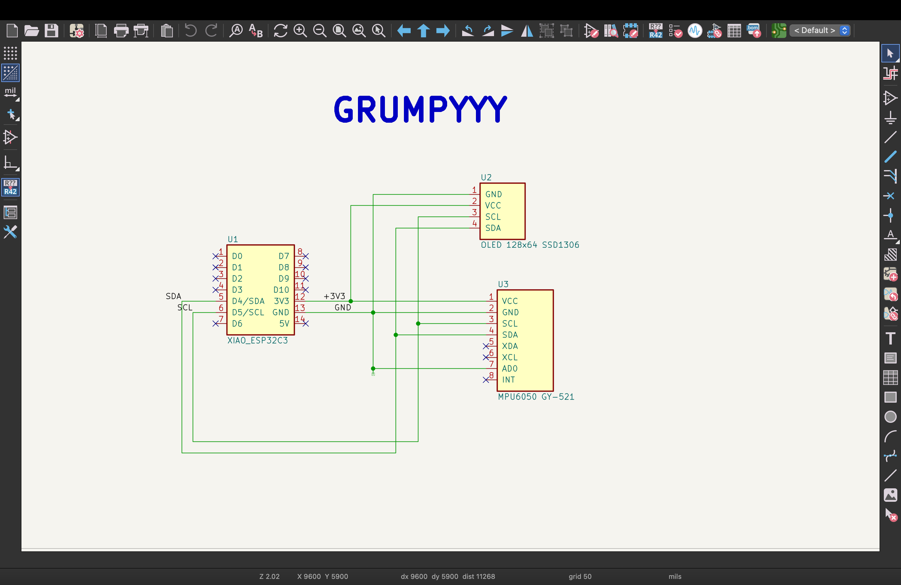

its only 4 nets, everything shares one i2c bus :

| xiao pin | oled | mpu6050 |
| --- | --- | --- |
| 3V3 | VCC | VCC |
| GND | GND | GND, AD0 |
| D4 (gpio6, SDA) | SDA | SDA |
| D5 (gpio7, SCL) | SCL | SCL |

AD0 on the mpu6050 goes to gnd so its address is 0x68, the oled sits at 0x3c, so no clash. XDA, XCL and INT on the mpu6050 arent used. modules run off 3v3, not 5v, since the xiao io is 3.3v

| xiao | oled | mpu6050 |
| --- | --- | --- |
| 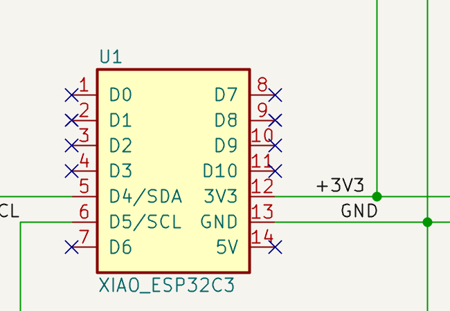 | 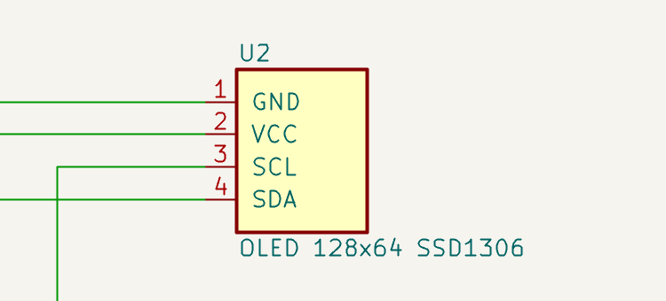 | 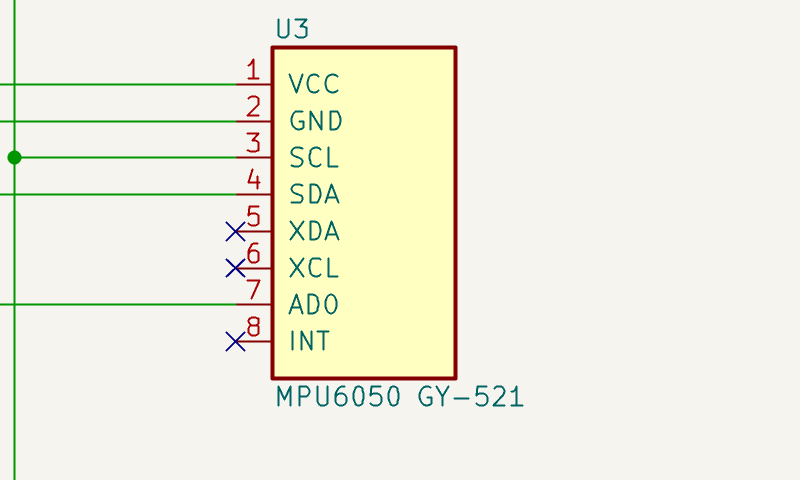 |

## the board

no custom pcb on this one, its all on a small perfboard. tried a couple of layouts and ended up with the mpu6050 above the oled and the xiao on the left with its usb-c right at the edge. the wiring is all on the back : red for 3v3, blue for gnd, green and yellow for sda and scl, plus a solder bridge along one row for gnd. after it worked i cut the extra board off so its around 48 x 44mm

| front | back |
| --- | --- |
|  | 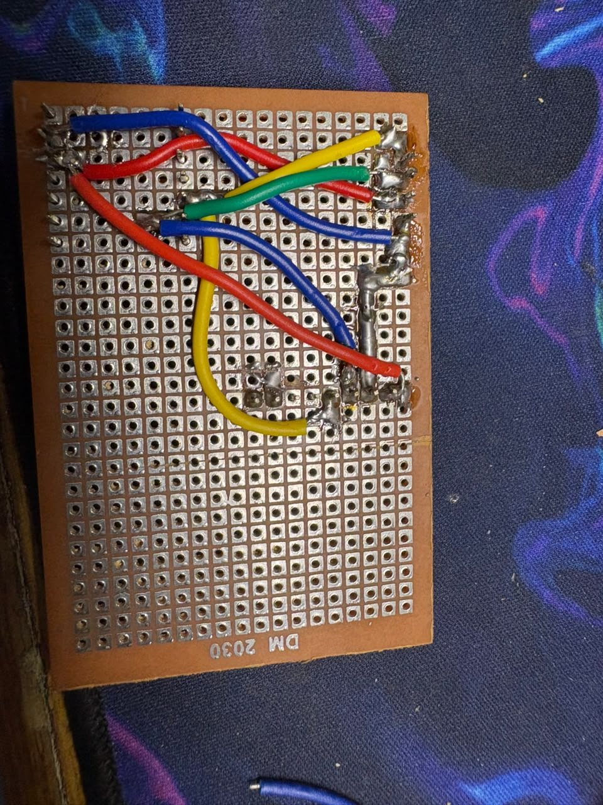 |

## case

designed in fusion 360 as a python script (`cad/GrumpyyyCase/GrumpyyyCase.py`), every size is a number at the top so you can measure your own board and run it again

- base : open box with 1.8mm walls, 4 corner posts the board sits on with 5mm of room underneath for wires, a usb-c cutout and a keyring tab with a 4.5mm hole
- lid : 1.6mm plate with a window for the oled and a 2mm lip that friction fits into the base (0.2mm clearance per side, bump to 0.3 if its tight). print it face down

| base | lid |
| --- | --- |
| 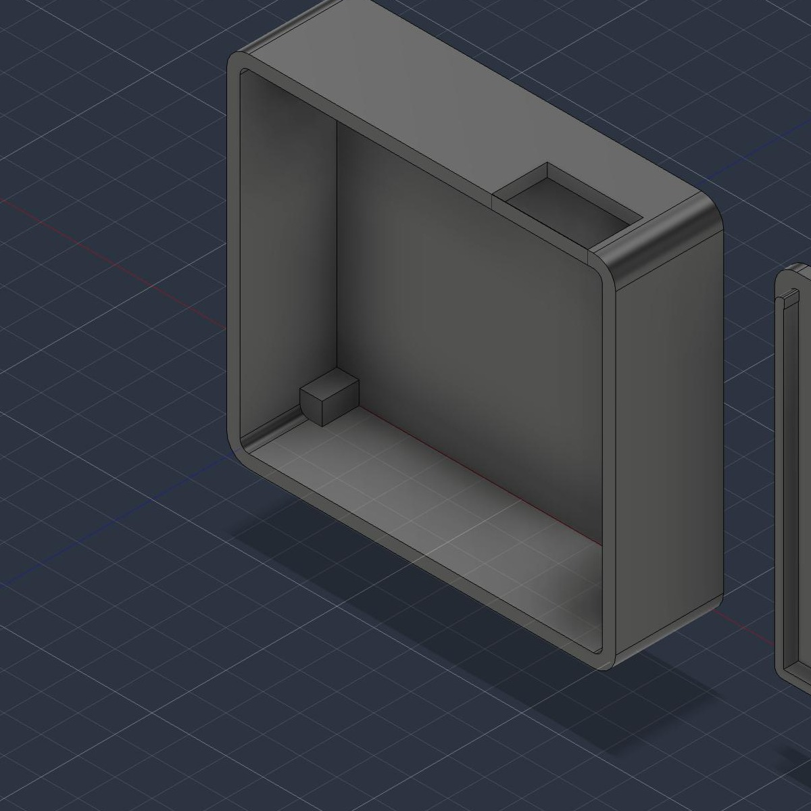 | 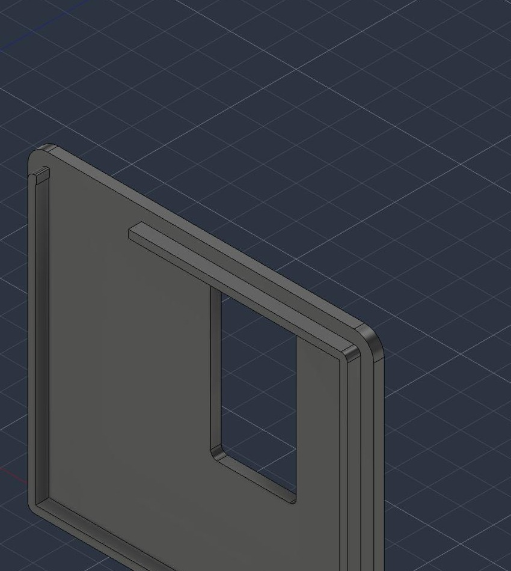 |

there's also a STEP of both parts in `cad/Grumpyyy-CAD.step`

## firmware

written in arduino, uses adafruit ssd1306 + adafruit gfx for the screen. the mpu6050 is read directly over i2c, no library : wake it up with 0x6B, set ±4g with 0x1C, read 6 bytes from 0x3B and divide by 8192 to get g

shake detection : when its still the total acceleration is about 1g whatever way its facing. more than 0.6g away from that counts as shaking. 2 seconds of shaking makes it angry, a gap longer than 0.4s resets the count. it runs as a little state machine with 3 moods, NORMAL, ANGRY and SAYING, and every shake while angry restarts the 5s timer

the angry eyebrows are just black triangles drawn over the top of the rounded rectangle eyes, slanting toward the middle, and they fade in instead of popping on. blinks happen at random times between 2 and 5 seconds

all the numbers you'd want to tweak are at the top of `Grumpyyy.ino` :

```cpp
const float    SHAKE_THRESHOLD_G = 0.6;   // lower = more sensitive
const uint32_t SHAKE_NEEDED_MS   = 2000;  // shake this long to get angry
const uint32_t SHAKE_GAP_MS      = 400;   // pause longer than this resets it
const uint32_t ANGRY_HOLD_MS     = 5000;  // angry for this long after the last shake
```

## building one

1. get the parts from the bom below
2. wire it on a breadboard first and check it works
3. in arduino ide install the esp32 boards and the adafruit ssd1306 + gfx libraries, select XIAO_ESP32C3 and turn on USB CDC On Boot
4. upload `firmware/Grumpyyy/Grumpyyy.ino`
5. solder it on perfboard following the schematic, check 3v3 and gnd arent shorted with a multimeter before plugging in
6. print the case, drop the board in and push the lid on

if the upload doesnt start, hold the B (boot) button while plugging it in. if the screen stays blank, check you're using gpio6/gpio7 for i2c (and try 0x3D if your oled has a different address)

## files

| folder | whats inside |
| --- | --- |
| `firmware/Grumpyyy` | main code, blinking, shake detection, angry eyes and the text |
| `firmware/faces` | separate sketches for normal, angry, round eyes and the text |
| `kicad` | kicad project and schematic |
| `cad` | fusion 360 script for the case and the STEP of the base and lid |
| `images`, `media` | photos, gif and testing video |
| `JOURNAL.md` | build journal |
| `BOM.csv` | parts list |

## bom

| part | qty | what its for | price (₹) |
| --- | --- | --- | --- |
| seeed studio xiao esp32-c3 | 1 | the brain, powered and programmed over usb-c | 500 |
| mpu6050 (gy-521) | 1 | detects the shake, i2c 0x68 | 130 |
| 0.96" 128x64 oled (ssd1306, i2c) | 1 | eyes and text, i2c 0x3c | 230 |
| perfboard, 2.54mm | 1 | everything is soldered on it, cut to ~48 x 44mm | 30 |
| hookup wire (red, blue, green, yellow) | 1 | wiring on the back | 40 |
| male header pins, 40 pin strip | 1 | for the oled and mpu6050 | 15 |
| pla filament, ~15 g | 1 | 3d printed base and lid | 30 |
| key ring, ~20mm | 1 | goes through the tab | 10 |
| solder wire | 1 | already had it | 0 |
| usb-c cable | 1 | power from the laptop, already had it | 0 |
| breadboard + jumper wires | 1 | testing only, already had them | 0 |
| **total** | | | **₹985** |

same list is in [BOM.csv](BOM.csv)

---

made by shadow, for my bro :D
